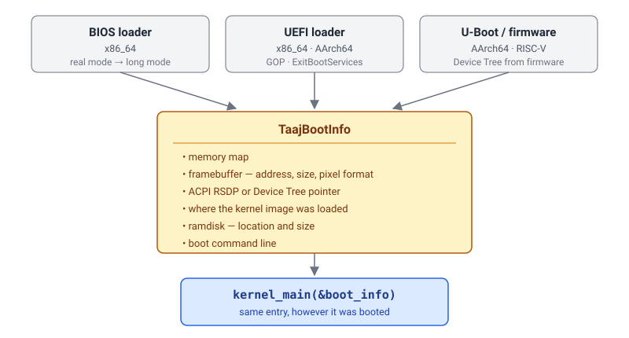
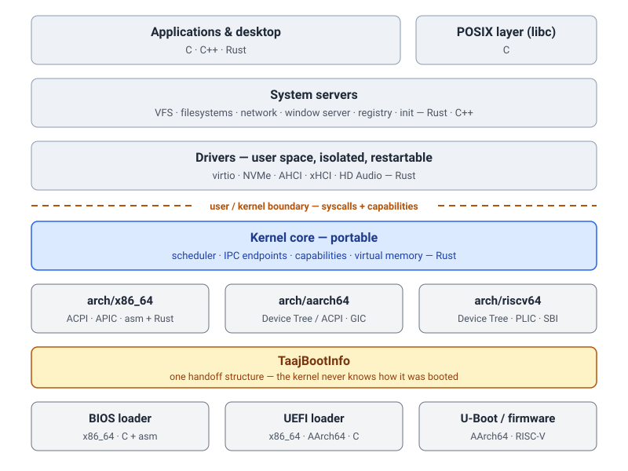
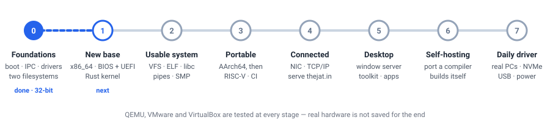

# TheTaaJ: Where It Is, Where It's Going

*Journal entry #1 · Vision & architecture*

TheTaaJ started as a way to learn how an operating system really works. It boots, it runs programs in ring 3, it has drivers in user space and two filesystems — and it has reached the point where "add the next feature" is no longer a plan. Before writing another line, I want to write down what TheTaaJ is supposed to become, the decisions that follow from that, and why I made each one.

This post is the reference for everything after it. When a later decision contradicts it, I'll come back and update it — and say so.

---

## Where TheTaaJ is today

The current system — tagged `v0.1-x86-32` — is a 32-bit x86 microkernel:

- **A two-stage bootloader** of my own, booting from an ISO, that loads the kernel and a ramdisk.
- **A small kernel** that does paging, threads, scheduling and a heap, and very little else. Its main job is moving messages between processes.
- **Three kinds of IPC.** Pipes for buffered messages; synchronous endpoints (`call` / `recv` / `reply`) that copy a message *once*, straight from the sender's memory into the receiver's; and shared memory for bulk data.
- **Capabilities.** A process can only talk to what it has been handed. A capability can be granted to another process, and the kernel stamps a *badge* on it so a server always knows who is calling.
- **No naming in the kernel.** Every process starts with exactly one capability — to the registry server. Names, lookup and ownership all live in user space.
- **A supervisor.** `init` starts every server, notices when one dies, and restarts it.
- **Drivers in user space.** The ATA disk driver claims I/O ports and IRQs through the kernel, then serves reads and writes from a shared window — a 4 KB read is one small message and no copying of the data itself.
- **Two filesystems behind one interface.** FAT32 on the first disk, and TaajFS — my own copy-on-write filesystem — on the second. The shell can `mount` either and doesn't know which one it's talking to.

The design rule that runs through all of it: **the kernel provides mechanism; everything that is a decision lives in user space.**

## Why rethink now

Everything above was built for 32-bit x86, booted one way, on one kind of machine. Every feature I add from here on is a feature I'd have to port later. The cheapest moment to change the foundation is before building more on top of it — so that's now.

## What I want TheTaaJ to become

**A desktop operating system that people can actually use every day** — one that fixes what I find frustrating about Windows and Linux rather than copying them.

That's a big sentence, so here is what I mean by each quality, and the concrete mechanism that delivers it. A goal without a mechanism is just a wish.

| Goal | How TheTaaJ delivers it |
|---|---|
| **Secure** | Capabilities only — no process has authority it wasn't explicitly given. W^X memory, ASLR, apps sandboxed by default. Rust for the code that parses untrusted input. |
| **Reliable** | A copy-on-write filesystem that survives power loss mid-write. Kernel code written in a language that rules out whole classes of memory bugs. |
| **Resilient** | Drivers and servers are ordinary processes under a supervisor. A crashed driver is restarted, not a blue screen. |
| **Modular** | Every service is a separate program behind an IPC protocol. Swap one out and nothing else notices — FAT32 and TaajFS already prove this. |
| **Extensible** | Protocols are described in an interface language and versioned, so new services and new versions can coexist. |
| **Efficient** | Zero-copy shared memory for bulk data; small messages for control. The disk path already works this way. |
| **Scalable** | Multiple CPU cores from the start of the 64-bit kernel; per-CPU run queues; IPC fast paths that don't take global locks. |
| **Observable** | Tracing and per-server metrics designed in from day one, not bolted on later. |
| **Responsive** | The input → UI → display path always runs first. Audio and input are never stuck behind disk I/O. |
| **Maintainable** | One stable ABI header shared by kernel and user space. Tests per server. Every architecture built and booted on every commit. |

It must run **in QEMU, VMware and VirtualBox, and on real PCs**, booting from **both legacy BIOS and UEFI**.

---

## The decisions

### 1. 64-bit only

TheTaaJ moves to **x86_64**, and 32-bit support goes away entirely. Supporting one word size means one set of assumptions in every data structure and far fewer `#ifdef`s. Every machine I'd want to run on is 64-bit anyway, and so is everything that makes a modern desktop work: more than 4 GB of RAM, many cores, modern devices.

### 2. Many architectures, in order

TheTaaJ should not be an "x86 OS". The order is:

1. **x86_64** — PCs and virtual machines.
2. **AArch64** — first on QEMU's `virt` machine, then on a Raspberry Pi.
3. **RISC-V 64** — once AArch64 has proven the design is really portable.

A microkernel is the best kind of OS to port, because the part that actually depends on the CPU is small. Here is what genuinely differs between the three:

| Concern | x86_64 | AArch64 | RISC-V 64 |
|---|---|---|---|
| Finding hardware | ACPI tables | Device Tree or ACPI | Device Tree |
| Interrupts | IDT + APIC | exception vectors + GIC | trap vector + PLIC |
| Entering the kernel | `syscall` | `svc` | `ecall` |
| Talking to devices | I/O ports **and** MMIO | MMIO only | MMIO only |
| Starting other cores | INIT-SIPI | PSCI | SBI |

That last-but-one row matters for code I've already written: my ATA driver uses `outb`, which only exists on x86. In the new design, drivers talk to "registers on a bus" through an abstraction, and the same driver works whether those registers are I/O ports or memory-mapped.

### 3. My own bootloader — for BIOS *and* UEFI

I'll keep writing my own bootloader rather than using an existing one. It's a long road, but the boot process is exactly the kind of thing I want to understand properly.

The key to supporting several boot methods without the work multiplying is **one handoff structure**:

Each bootloader — BIOS, UEFI, and later U-Boot on ARM and RISC-V — does whatever its firmware requires, then fills in the same `TaajBootInfo`: the memory map, the framebuffer, a pointer to the ACPI tables or Device Tree, where the kernel and ramdisk were loaded, and the command line. The kernel starts from that structure and **never knows how it was booted**. Adding a new boot method never touches the kernel.

### 4. The right language for each layer

TheTaaJ will mix **C, C++ and Rust**. That sounds messy, but in a microkernel it's natural: every server is a separate program behind IPC, so they don't have to share a language. The rule:

> **Rust where code handles untrusted input or manages memory. C where the ABI or the hardware demands it. C++ where large object-oriented frameworks help.**

| Layer | Language | Why |
|---|---|---|
| BIOS boot stages | Assembly + C | 16-bit real mode is hostile to anything higher-level. |
| UEFI bootloader | C | Shares the ELF loader and `TaajBootInfo` code with the BIOS loader. |
| Entry, traps, context switch | Assembly | Unavoidable — and kept as small as possible, per architecture. |
| **Kernel core** | **Rust** | See below. |
| Drivers | Rust | Hardware and DMA are untrusted input. Most kernel security bugs in mainstream systems are in drivers. |
| Filesystems, network stack | Rust | They parse data from disks and networks — exactly where memory bugs become security holes. |
| libc / POSIX layer | C | POSIX *is* a C interface. Ported software expects real C headers. |
| GUI toolkit, desktop apps | C++ (or Rust) | GUI frameworks benefit from classes and templates. |

Two things make the mix work. First, **the C ABI is the common language at every boundary** — Rust, C++ and C all speak it. Second, **IPC protocols are written once in an interface definition language** and C, C++ and Rust bindings are generated from it. Today every protocol is a hand-written C header; that doesn't scale to three languages.

#### Why the kernel is moving to Rust

This is the biggest decision in this post, and I'm a Rust beginner, so it deserves an honest explanation.

- **The 64-bit port is effectively a new kernel.** New paging, new interrupt handling, new system call entry, a new architecture layer. If I'm writing it anyway, this is the cheapest moment I will ever have to change language.
- **My goals are security and reliability.** Rust rules out use-after-free, buffer overflows and data races at compile time. The last one matters enormously once the kernel runs on several cores at once. C can't give me that.
- **Nothing I've learned is lost.** The 32-bit C kernel becomes the *reference design*. Endpoints, badges, the copy window, the registry bootstrap, the supervisor — the concepts carry over, and I'll be re-implementing them knowing exactly why each one exists.
- **It's a proven path.** Redox, Theseus, Asterinas and Hubris are kernels written in Rust, and both Linux and Windows now accept Rust code in their kernels.

The cost is real: I'm learning Rust and OS internals at the same time. Kernel Rust still needs `unsafe` for page tables and device registers, and part of the learning is understanding why that's still far safer overall. I'll write about that learning as I go — the confusing parts included.

### 5. Clang/LLVM instead of GCC

The toolchain moves from my custom GCC cross-compiler to **Clang + LLD**, alongside **rustc**. Two reasons:

- **One compiler for every architecture.** Clang targets x86_64, AArch64 and RISC-V with a flag. GCC needs a separate cross-compiler built for each.
- **One backend for every language.** rustc is built on LLVM too, so C, C++ and Rust objects link together reliably.

Eventually TheTaaJ gets its own target, `x86_64-unknown-taaj`, so programs are built *for TheTaaJ* — the step that makes porting software practical.

### 6. Native API first, POSIX on top

This is a real fork in the road:

- **Pure POSIX** makes it easy to port existing software, but it drags the design towards Unix — `fork`, a global file-descriptor table, signals.
- **A pure native API** keeps the capability design clean, but every program would have to be written from scratch.

TheTaaJ takes the **middle path**, like Fuchsia and Redox: a native, capability-based API at the core, and a **POSIX compatibility layer** built *on top* of it in user space. Native programs get the clean design. Ported programs get a familiar libc. The kernel never has to learn what `fork` is.

---

## The architecture

Reading from the bottom:

- **Bootloaders** do whatever the firmware requires and produce a `TaajBootInfo`.
- **The architecture layer** is the only part of the kernel that knows which CPU it's on. One directory per architecture, small, mostly assembly and low-level Rust.
- **The kernel core** — scheduler, IPC, capabilities, virtual memory — is portable Rust that never touches the hardware directly.
- **Above the boundary, everything is a process.** Drivers, filesystems, the network stack, the window server — isolated from each other, restartable, and talking only through capabilities they were given.

The kernel stays small on purpose. Everything that can be a decision lives above that dashed line.

## The hard part: drivers

The kernel is not what stops a hobby OS from becoming a daily-use desktop. **Drivers are** — above all graphics, Wi-Fi and laptop power management. Every OS project hits this wall, so I'd rather plan for it now:

1. **Standard device classes first.** AHCI and NVMe for storage, xHCI for USB, HD Audio, common Intel and Realtek network cards. Each driver covers thousands of machines.
2. **virtio early.** QEMU's virtual devices work the same on every architecture, so the entire stack — disk, network, GPU, input — can be portable before I face real hardware.
3. **The UEFI framebuffer for graphics.** Not accelerated, but it works on almost every PC.
4. **Later, a compatibility layer for existing drivers.** Projects like Genode and NetBSD's rump kernels run drivers from other systems in isolation. In a microkernel that's a natural fit: a borrowed driver becomes just another restartable process.

---

## The roadmap

Each era has a test that says when it's done — "done" should never be a feeling.

| Era | Goal | Done when… |
|---|---|---|
| **0 · Foundations** ✅ | Boot, memory, IPC, capabilities, user-space drivers, two filesystems | Done — `v0.1-x86-32` |
| **1 · New base** | x86_64; my own BIOS and UEFI loaders; `TaajBootInfo`; Rust kernel core with IPC and capabilities rebuilt | The Rust kernel boots from both BIOS and UEFI and runs the registry and init |
| **2 · Usable system** | VFS, programs loaded from disk as ELF files, libc, pipes in the shell, multiple cores | I compile a C program on my host, copy it to the disk, and run it from the shell — on four cores |
| **3 · Portable** | AArch64 on QEMU `virt`, then a Raspberry Pi; RISC-V after; every architecture booted on every commit | The same user space boots on x86_64 and AArch64 |
| **4 · Connected** | A network driver and a TCP/IP stack | **TheTaaJ serves a page of thejat.in itself** |
| **5 · Desktop** | Framebuffer, window server, GUI toolkit, apps | I write a journal entry in a text editor running on TheTaaJ |
| **6 · Self-hosting** | Port a C compiler — TCC first, then Clang | TheTaaJ builds TheTaaJ |
| **7 · Daily driver** | NVMe, USB, ACPI power management, real-hardware polish | It boots from a USB stick on my own PC and I use it for a day |

Real hardware isn't saved for the end: QEMU, VMware and VirtualBox get tested at every stage, and real PCs as soon as the new base boots.

## How I'm going to work — and write

The point of TheTaaJ is to **understand every part of it**, not just to make it run. So every feature follows the same loop:

1. **The concept first** — what problem it solves and how other systems solve it.
2. **The design decision** — the options and why I chose one.
3. **Build it.**
4. **Prove it works** — ideally with something independent of the OS checking the result, the way `tfstool` on the host checks what TheTaaJ wrote to a TaajFS disk.
5. **Write it up here** — including what went wrong.

Alongside the main entries, I'll keep a series on **learning Rust while building an OS**, from a beginner's point of view.

## What's next

Two things happen in parallel:

- **Learning Rust on familiar ground.** I'm rewriting `tfstool` — the host tool that formats and inspects TaajFS disks — in Rust. I know exactly what it must do, and the C version is there to check it against.
- **Starting the new base.** My bootloader learns to switch the CPU into 64-bit long mode and hand over a `TaajBootInfo`, and the first Rust kernel prints *"Hello from TheTaaJ"* over the serial port.

The next entry will be about one of those two — whichever teaches me more first.
