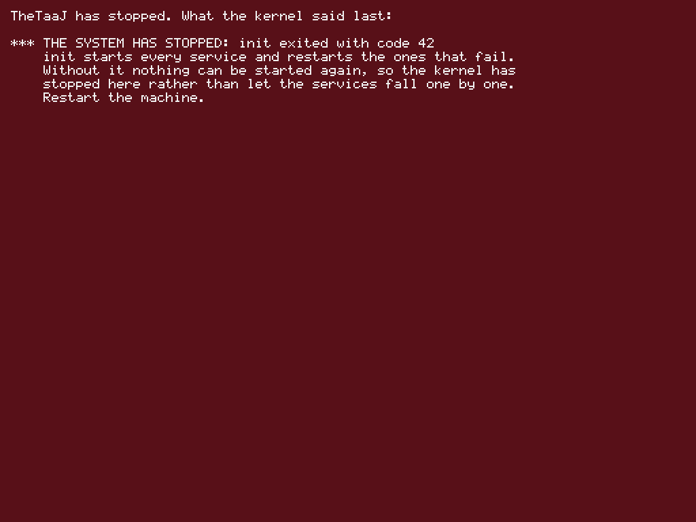
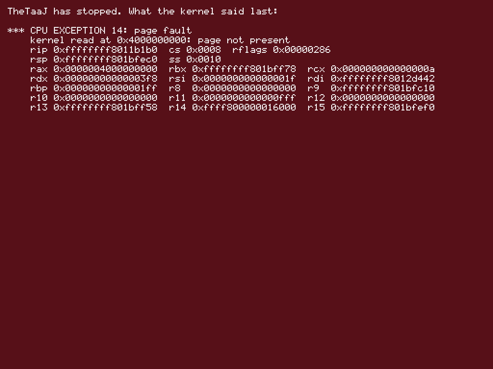

# Last Words: the Kernel Says Why It Stopped, and a Screen That Survives Its Display

*Journal entry #25 · init's end is the system's end; a panic screen; text kept across a display restart*

Two loose ends from entry #24, and they turned out to be the same subject seen from two sides: **what is on the screen when something dies.**

- When the *display service* is replaced, the screen came back blank. The text was in the dead process.
- When *init* dies, the whole system fell over in good order, one service after another, and the screen simply froze — with nothing anywhere to say why.

---

## Part 1: a screen that survives its display

### Where state lives decides what survives

The watchdog (entries #23, #24) can replace a hung display in three seconds. But the new display started with an empty grid: the characters on the screen were a `static` inside the old process, and went with it. The pixels were still in the framebuffer for a moment — then the new display painted over them.

The lesson is one this project keeps meeting: **a restartable service is only as good as the state it does not keep.** The file service survives restart because its state is on the disk (entry #15). The request queues survive because init holds the channels (entry #10). The display's text had no home outside the display.

So init now gives it one: a 64 KiB **memory object** (entry #11), created once, owned by init, and lent — mapped read-write — to each display process in turn. The display's text grid lives *in that memory* rather than in its own:

```rust
let grid: &mut Grid = match kept {
    // SAFETY: a mapping at least as big as a Grid, page-aligned,
    // this process's alone while it runs; and every field of Grid is
    // a plain integer, so whatever bytes are there are *a* Grid -
    // whether one to trust is `adopt`'s question, below.
    Some(base) => unsafe { &mut *base.cast::<Grid>() },
    None => /* the old static, if init gave no memory */,
};
```

No copying, no "save" step that a crash could interrupt. The grid the display writes into *is* the saved copy. When the process dies, the mapping goes; the memory object stays, because init still holds its handle (a mapping is a reference, and so is a handle — entry #11). The next display maps it and finds the text.

### Trusting what a dead process left behind

Here is the danger, and it is the important part. The last thing in that memory was written by a process that **crashed or hung**. It may have died halfway through a change. Its bug may be the very thing that corrupted the grid. If the new display trusts it blindly — say, a cursor position beyond the array — the new display crashes on its first character, restarts, finds the same memory, and crashes again. Kept state turns one crash into a crash loop.

So the state is not *loaded*; it is **adopted**, after a check:

```rust
pub fn adopt(&mut self, columns: usize, rows: usize) -> bool {
    let sound = self.columns == columns
        && self.rows == rows
        && (1..=MAX_COLUMNS).contains(&columns)
        && (1..=MAX_ROWS).contains(&rows)
        && self.column <= self.columns // == columns: about to wrap
        && self.row < self.rows
        && self.continuation <= 3;
    if sound {
        for cell in self.cells.iter_mut().flatten() {
            if !(0x20..=0x7E).contains(cell) {
                *cell = b' ';
            }
        }
    }
    sound
}
```

Three things make this safe rather than hopeful:

1. **Every field of the grid is a plain integer.** There are no pointers, no enums, no references in it. Any pattern of bytes is *a* grid — possibly a nonsensical one, but reading it cannot itself be undefined behaviour. That is what makes it legitimate to look at all.
2. **The check is exactly what the code relies on.** `write` indexes the array with `row` and `column`; so those are what must be in range. Nothing more needs to be believed.
3. **The contents are sanitised, not validated.** A cell holding a byte that is no character becomes a space. Text cannot be "wrong" in a way that crashes anything.

Anything that fails — a different screen size, a cursor out of range, memory that was never a grid — and the display starts empty, as before. The host tests feed `adopt` a grid of the wrong size, each field out of range in turn, and memory filled with zeros and with `0xFF`.

`adopt` lives in the `console` crate, beside the grid it judges, and is tested there.

### What you see

```
[display] asked to stall: drawing nothing for 600 ticks
[init] display has not answered for 2 s - stopping it
[init] display ended with code -1001 - restarting it
[display] painted the 1024x768 screen from ring 3 …; console 80x33
[display] the text on the screen was kept: 33 lines shown again
```

The screen freezes for about three seconds, then continues — same text, same cursor — and whatever was typed meanwhile appears.

One honest gap: text sent *while* the display was dead is lost if it reached the queue before the new display's first message. The new display discards everything queued ahead of its `INFO` (entry #11), because it cannot tell old text from new. Usually that is a line or two.

## Part 2: when init ends

### What used to happen

Entry #24 found this by accident. A bad argument made init exit with code 3, and the log read:

```
[process] 33 "init" exited with code 3
[shell] the keyboard driver is gone
[process] 37 "shell" exited with code 0
[process] 34 "display" exited with code 0
[process] 35 "fs" exited with code 0
[process] 36 "blk" exited with code 0
```

Every one of those lines is *correct behaviour*. init holds an end of every channel between services. When it exits, its handles close; each service sees a peer vanish and, as designed, ends cleanly. The system dismantled itself politely and left a frozen screen and a log of ordinary exits — with the one line that mattered buried at the top, looking like any other.

There is no recovering from this. The process that restarts things is the one that ended; nothing else holds the launcher. Unix reaches the same conclusion in a famous message: *"Kernel panic — not syncing: Attempted to kill init!"*

### What happens now

The kernel marks the process it starts as init as **essential**. When an essential process ends, by any route — exit, a fault, a kill — the kernel stops, at once, and says why:

```rust
fn stop_the_system(name: &str, how: core::fmt::Arguments) -> ! {
    crate::arch::disable_interrupts();
    unsafe { crate::console::break_lock() };
    kprintln!();
    kprintln!("*** THE SYSTEM HAS STOPPED: {name} {how}");
    kprintln!("    {name} starts every service and restarts the ones that fail.");
    ...
    crate::arch::halt_forever()
}
```

It is called from the one function every ending goes through (`end_current`, entry #17), so there is no way for init to end that misses it.

**Why stop, rather than start a new init?** Because a new init would need what the old one was given and has lost: the kernel hands init the devices once, at boot — the framebuffer, the disk's ports and DMA memory, the interrupts — as handles in a message. They closed with init. A second init is a second boot of user space, and doing that properly (which services are still alive? who holds what?) is a real piece of design, not a patch. Stopping with a clear reason is the honest version of what was already happening.

## Part 3: the screen, at the end

### The problem with "says why"

The kernel's messages go to the serial port. On my desk, in QEMU, that is a terminal. On a real PC there is no one listening to a serial port. A kernel panic, a fatal exception, init's end — the user would see the screen freeze and nothing else. Every useful thing the kernel has to say at that moment (entry #3 was about making it say them) would be said to nobody.

The kernel gave the screen away in entry #11, and that was right: drawing is a service's job. But there is one moment when no service can be relied on, and that is exactly the moment the message matters most.

### Taking the screen back, once

`lastwords.rs` is the kernel's one piece of drawing code. Its rule: **do nothing risky at the time of death.**

- **At boot**, while the kernel is healthy, `prepare` maps the framebuffer and works out the two colours in the screen's pixel format. Mapping needs the page tables and their lock — things that may be broken, or held, later.
- **At the end**, `begin` paints the whole screen a dark red and writes a heading. It takes no lock, allocates nothing, and cannot fail: it stores pixels through a pointer that was made ready long before.

It is switched on from the one place every fatal path already goes through. Both the panic handler and the exception handler call `console::break_lock()` just before they print (entry #6: "when the kernel is dying, it breaks the console lock"). That function now also begins the last words — and from then on, the console writer draws everything it prints:

```rust
impl Write for Console {
    fn write_str(&mut self, text: &str) -> fmt::Result {
        crate::arch::console_write(text);
        // And on the screen - once the kernel has taken it, to stop.
        crate::lastwords::echo(text);
        Ok(())
    }
}
```

So nothing else in the kernel changed. The panic message, the exception name, the page-fault decoding, the register dump — every line that already went to the serial port now also appears on the screen, because they all go through one writer. No second copy of any message to keep in step.

The font is the display's own (the `console` crate, entry #11) — the kernel gained one dependency and no new glyphs.





### Why red, and why the whole screen

The display's screen is blue with an amber band. The kernel's is a flat dark red, edge to edge. Two reasons: a person should see at a glance that this is *not* the system running; and painting everything means the message is never mixed with half a screen of old text. It also gives the test something unambiguous to check.

### What it cannot do

- If the fault is in the page tables themselves, or the framebuffer mapping is the thing that is broken, drawing may fault — inside a fault handler. The double-fault handler has its own stack (entry #3), so the likely worst case is a second report on the serial port. I have not found a way to test that.
- 32-bit pixels only; on anything else it stays silent, as the display would.
- It does not scroll. A report longer than the screen loses its end, and the *end* of a register dump is the least useful part.

## How I checked it

**Every kernel death is now a screen test.** The fault tests (entry #4) boot one kernel per deliberate fault. Each of those boots ends with a screenshot, and a new script, `check-last-words.py`, requires:

- the four corners and the bottom edge to be the kernel's red — so the *whole* screen was taken, not a patch;
- at least 300 sampled pixels of light text — so something was written.

A fault reported on the serial port but not on the screen now **fails** the test, with its own message.

**A seventh fault test: `fault-init`.** In that build the kernel starts `hello` — a program that prints and exits with code 42 — in init's place. The boot must end with:

```
*** THE SYSTEM HAS STOPPED: init exited with code 42
```

and with the red screen.

**The display's kept text:** the boot test's `display stall` must now be followed by `the text on the screen was kept: N lines shown again`, and three new host tests cover `adopt`.

I also looked at the screenshots myself — the two above are from the test run. A pixel-count check passing is not the same as a person being able to read the message.

`make test64`: all passed in one run — host tests, BIOS and UEFI boots, seven fault boots.

## What I learned

- **State outside the process is what makes a process replaceable.** Disk for files, init's channels for queues, init's memory for the screen. Each time, the question is "who holds this when the worker is gone?"
- **Adopt, do not load.** State left by a failed process is evidence from a crime scene. Check exactly the invariants the code depends on; sanitise the rest; fall back to empty.
- **Plain data is what makes that possible.** A structure with a pointer in it could not be looked at safely.
- **A correct sequence of events can be the wrong outcome.** Every service exiting cleanly *was* the bug.
- **Get ready while healthy.** Whatever must work at the moment of failure has to be prepared before it, and must need nothing at the time.
- **One writer, many destinations.** Because every message already went through one function, a new place for messages was one line.

---

## Testing note

**The screen surviving its display**

```
make run64
```

| Type | You should see |
|---|---|
| `help`, then `ls` | A screen with plenty of text on it |
| `display stall 20` | `display: the screen will show nothing for 20 s`, then the screen freezes |
| Type `echo hidden` and Enter during the freeze | Nothing yet |
| (about 3 seconds after the stall began) | The screen comes back **with the same text** — not blank — and the cursor where it was. `hidden` may or may not appear (see "One honest gap") |
| `echo after` | `after`, on the next line, continuing the old text |

Log: `[display] the text on the screen was kept: N lines shown again`.

**The kernel's last words** — these are separate builds; each stops the machine on purpose:

```
make fault64-test
```

It should print seven lines ending in `ok`, the last being `fault-init: ok (THE SYSTEM HAS STOPPED: init exited with code 42)`.

To *see* a last-words screen yourself, the screenshots of that run are left in `build/`:

```
build/fault64-init.log.ppm          init ended
build/fault64-page.log.ppm          a page fault in the kernel
build/fault64-stack.log.ppm         a kernel stack overflow
```

(most image viewers open `.ppm`; `eog build/fault64-init.log.ppm` on Ubuntu). Each should be a dark red screen headed `TheTaaJ has stopped. What the kernel said last:` followed by the report — compare with the two pictures above.

To see it live in a window instead of a file:

```
qemu-system-x86_64 -m 512M -cdrom build/fault64-init.iso -boot d -serial stdio
```

The red screen should appear within a few seconds of the loader finishing.

**In normal use** you should never see the red screen. If you do, it is a real kernel failure — and for the first time the screen itself will tell you what: please send me a photo or the text.

Automated: `make test64`.
